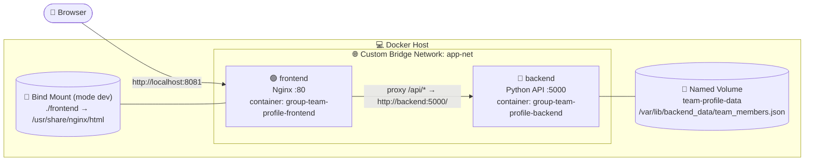
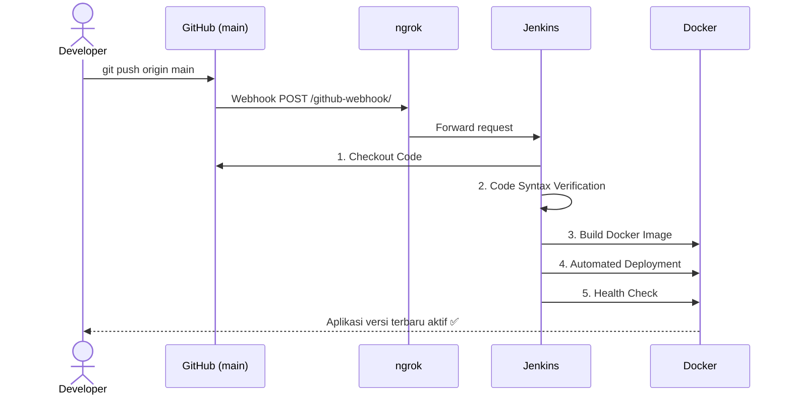

# 👥 Group Team Profile Showcase

**Cloud-Native Fullstack Application & Automated CI/CD Pipeline**
Ujian Chunin – Mata Kuliah Cloud Computing, Telkom University


---

## 📌 1. Identitas Kelompok

| No | Nama Lengkap | NIM | Peran |
|----|--------------|-----|-------|
| 1 | Devita Syifa Azzahraa | 101012580011 | Frontend Engineer |
| 2 | Ichsan Ahmad Wibowo | 101012500071 | Backend Engineer |
| 3 | Dikri Nugraha | 101012580013 | UI/UX Designer |
| 4 | Dzaky Ahmad | 101012580027 | DevOps Engineer (Docker & Jenkins CI/CD) |

- **Mata Kuliah:** Cloud Computing
- **Dosen Pengampu:** CSO
- **Studi Kasus Dipilih:** **No. 10 – Portofolio & Profil Kelompok (Group Team Profile Showcase)**
- **Repositori:** https://github.com/devitasyifaa-git/group-team-profile

---

## 📖 2. Deskripsi Proyek

Aplikasi web fullstack untuk menampilkan **profil anggota kelompok beserta keahlian (skill)**. Pengguna dapat melihat kartu profil, menambah anggota baru melalui form, dan menghapus anggota secara real-time tanpa refresh halaman.

Fokus proyek ini adalah penerapan arsitektur *cloud-native* dan DevOps:

- **Containerization** dengan Docker (2 image: backend & frontend)
- **Persistensi data** dengan **Docker Named Volume** (`team-profile-data`)
- **Live reload UI** dengan **Bind Mount** pada kontainer Nginx
- **Isolasi jaringan** dengan **Custom Bridge Network** (`app-net`)
- **Orkestrasi deklaratif** dengan **Docker Compose**
- **CI/CD otomatis** dengan **Jenkins + GitHub Webhook** (via ngrok)

---

## 🛠️ 3. Teknologi

| Komponen | Teknologi | Keterangan |
|----------|-----------|------------|
| Backend | Python 3.11 (`backend/app.py`) | REST API murni dengan `http.server` (tanpa framework) |
| Frontend | HTML + CSS + Vanilla JS | `index.html`, `style.css`, `script.js`; komunikasi via `fetch()` |
| Web Server | Nginx (alpine) | Menyajikan frontend & **reverse proxy** `/api/` → backend |
| Storage | Named Volume `team-profile-data` | Menyimpan `team_members.json` |
| Network | Custom Bridge `app-net` | Komunikasi antar-kontainer via nama service (DNS Docker) |
| CI/CD | Jenkins Declarative Pipeline | 5 stage |
| Trigger | GitHub Webhook + ngrok | Auto-deploy saat `git push` ke `main` |

---

## 🏗️ 4. Arsitektur

### 4.1 Diagram Arsitektur Docker



**Poin penting desain:**

- Hanya **frontend** yang dipublikasikan ke host (port `8081` → `80`). Backend hanya `expose 5000` di dalam `app-net`, sehingga **tidak dapat diakses langsung dari luar** (isolasi).
- Browser memanggil `/api/...` ke Nginx, lalu Nginx meneruskannya ke `http://backend:5000/` menggunakan **DNS Docker (service name)**.
- Backend memiliki **healthcheck** (`GET /health`), dan frontend baru dijalankan setelah backend `healthy` (`depends_on: condition: service_healthy`).

| Jenis Storage | Dipakai oleh | Tujuan |
|---------------|--------------|--------|
| **Named Volume** `team-profile-data` | Backend | Data JSON tetap aman walau kontainer dihapus (*Data Immunity*) |
| **Bind Mount** `./frontend` | Frontend (Nginx), mode development (`docker-compose.dev.yml`) | Perubahan UI langsung terlihat tanpa rebuild image |

> **Mengapa Bind Mount dipisah ke `docker-compose.dev.yml`?**
> Jenkins berjalan di dalam kontainer (`jenkins-server`) dan memakai Docker Desktop lewat socket. Path relatif `./frontend` saat deploy lewat Jenkins akan menunjuk ke folder workspace di dalam kontainer Jenkins, bukan ke folder di host, sehingga hasil mount menjadi kosong. Karena itu:
> - `docker-compose.yml` (dipakai Jenkins) → frontend memakai image hasil `COPY` (stabil untuk deployment).
> - `docker-compose.dev.yml` (dipakai lokal) → menambahkan Bind Mount untuk live-edit UI.

### 4.2 Diagram Alur CI/CD



---

## 📂 5. Struktur Repositori

```
group-team-profile/
├── backend/
│   ├── app.py               # REST API Python (GET, POST, DELETE /members)
│   └── Dockerfile           # Image backend (python:3.11-slim)
├── frontend/
│   ├── index.html           # Halaman utama
│   ├── style.css            # Styling
│   ├── script.js            # Logika fetch() ke API
│   ├── nginx.conf           # Web server + reverse proxy /api/
│   └── Dockerfile           # Image frontend (nginx:alpine)
├── docker-compose.yml       # Stack: backend, frontend, volume, network (dipakai Jenkins)
├── docker-compose.dev.yml   # Override development: Bind Mount frontend
├── Jenkinsfile              # Declarative Pipeline (5 stage)
├── .dockerignore
├── .gitignore
└── README.md
```

---

## 🔌 6. Dokumentasi REST API

API diakses **melalui frontend (reverse proxy)**: `http://localhost:8081/api`

| Method | Endpoint | Deskripsi | Response sukses |
|--------|----------|-----------|-----------------|
| `GET` | `/api/health` | Cek status layanan | `200` `{"status":"active",...}` |
| `GET` | `/api/members` | Daftar seluruh anggota | `200` `{"members":[...],"total":N}` |
| `POST` | `/api/members` | Tambah anggota baru | `201` `{"status":"created","member":{...},"total":N}` |
| `DELETE` | `/api/members?index=X` | Hapus anggota berdasarkan index | `200` `{"status":"deleted","removed":{...},"total":N}` |

**Body POST (JSON):**

```json
{
  "name": "Nama Lengkap",
  "nim": "1234567890",
  "role": "Backend Developer",
  "bio": "Deskripsi singkat (opsional)",
  "skills": ["Python", "Docker"]
}
```

> `name`, `nim`, dan `role` **wajib** diisi. `skills` boleh berupa array atau string dipisah koma. Field `created_at` ditambahkan otomatis oleh server.

**Error handling:**

| Kode | Kondisi |
|------|---------|
| `400 Bad Request` | Body kosong / bukan JSON valid / bukan object; `name`, `nim`, `role` kosong; `skills` tidak valid; parameter `index` hilang atau bukan angka |
| `404 Not Found` | Endpoint tidak dikenal atau `index` di luar jangkauan |

**Contoh penggunaan (curl):**

```bash
# Lihat semua anggota
curl http://localhost:8081/api/members

# Tambah anggota
curl -X POST http://localhost:8081/api/members \
  -H "Content-Type: application/json" \
  -d '{"name":"Budi","nim":"1234567890","role":"DevOps","skills":["Docker","Jenkins"]}'

# Hapus anggota index ke-0
curl -X DELETE "http://localhost:8081/api/members?index=0"
```

---

## 🚀 7. Instalasi & Menjalankan Secara Lokal

### Prasyarat

- Docker Desktop / Docker Engine + Docker Compose v2
- Git

### Langkah

```bash
# 1. Clone repositori
git clone https://github.com/devitasyifaa-git/group-team-profile.git
cd group-team-profile

# 2. Build & jalankan seluruh stack
docker compose up -d --build

# 3. Cek status (backend harus "healthy")
docker compose ps

# 4. Buka aplikasi di browser
#    http://localhost:8081
```

### Mode Development (dengan Bind Mount)

```bash
docker compose -f docker-compose.yml -f docker-compose.dev.yml up -d --build
```

Folder `./frontend` di-mount ke `/usr/share/nginx/html`, sehingga edit `index.html`, `style.css`, atau `script.js` langsung terlihat setelah refresh browser. Untuk kembali ke mode normal: `docker compose up -d --build`.

> Port `8081` dipilih karena port `8080` sudah dipakai Jenkins. Jika muncul error *port is already allocated*, pastikan tidak ada kontainer lain di port `8081`.

### Perintah berguna

```bash
docker compose logs -f                 # Lihat log
docker compose down                    # Hentikan stack (volume TETAP aman)
docker network inspect app-net         # Cek custom bridge network
docker volume ls                       # Cek named volume
docker volume inspect team-profile-data
```

> ⚠️ **Jangan** menjalankan `docker compose down -v` karena akan **menghapus Named Volume** beserta seluruh data.

---

## 🧪 8. Pembuktian Data Immunity (Named Volume)

```bash
# 1. Tambahkan data lewat UI atau curl, lalu cek
curl http://localhost:8081/api/members

# 2. Hancurkan paksa kontainer backend
docker rm -f group-team-profile-backend

# 3. Jalankan ulang
docker compose up -d

# 4. Cek lagi -> data HARUS tetap ada
curl http://localhost:8081/api/members
```

✅ Data tetap ada karena `team_members.json` disimpan di Named Volume `team-profile-data` (mount ke `/var/lib/backend_data`), bukan di filesystem kontainer.

## 🔄 9. Pembuktian Bind Mount (Frontend)

1. Jalankan mode development:
   ```bash
   docker compose -f docker-compose.yml -f docker-compose.dev.yml up -d --build
   ```
2. Verifikasi mount: `docker inspect group-team-profile-frontend --format "{{json .Mounts}}"` → terlihat `"Type":"bind"`.
3. Ubah teks/warna di `frontend/index.html` atau `frontend/style.css`, simpan, lalu **refresh browser** (Ctrl + F5).
4. Perubahan langsung tampil **tanpa** `docker build` ulang.

---

## ⚙️ 10. Setup Jenkins CI/CD

### 10.0 Lingkungan Jenkins (Docker Desktop, Windows)

Jenkins berjalan sebagai kontainer `jenkins-server` (`jenkins/jenkins:lts-jdk17`, port `8080`) dengan:

- Docker socket host ter-mount di `/var/run/docker.sock`, sehingga Jenkins mengendalikan Docker Desktop.
- Docker CLI tersedia lewat volume `jenkins-docker-cli` (`/opt/docker-cli`).
- Volume `jenkins-data` di `/var/jenkins_home` untuk menyimpan konfigurasi Jenkins.

Docker CLI di kontainer awalnya **belum memiliki plugin `docker compose`**. Plugin dipasang satu kali (tersimpan di volume `jenkins-data`):

```powershell
docker exec jenkins-server sh -c 'mkdir -p /var/jenkins_home/.docker/cli-plugins'
docker exec jenkins-server sh -c 'curl -fL "https://github.com/docker/compose/releases/latest/download/docker-compose-linux-x86_64" -o /var/jenkins_home/.docker/cli-plugins/docker-compose'
docker exec jenkins-server sh -c 'chmod 755 /var/jenkins_home/.docker/cli-plugins/docker-compose'

# Verifikasi
docker exec jenkins-server docker compose version
docker exec jenkins-server docker ps
```

### 10.1 Membuat GitHub Personal Access Token (PAT)

1. GitHub → foto profil → **Settings**
2. **Developer settings** → **Personal access tokens** → **Tokens (classic)** → **Generate new token (classic)**
3. **Note:** `Jenkins CI/CD UTS Token`, **Expiration:** 30 atau 90 days
4. Centang izin: ✅ `repo` dan ✅ `admin:repo_hook`
5. **Generate token**, salin `ghp_xxxx...` (hanya tampil sekali)

### 10.2 Menambahkan Credentials di Jenkins

`Manage Jenkins` → `Credentials` → `Global` → `Add Credentials`

| Field | Isi |
|-------|-----|
| Kind | Username with password |
| Username | `devitasyifaa-git` |
| Password | PAT (`ghp_xxxx...`) |
| ID | `github-pat` |

### 10.3 Membuat Pipeline Job

1. **New Item** → isi nama job → pilih **Pipeline** → OK
2. Pada **Build Triggers** centang ✅ **GitHub hook trigger for GITScm polling**
3. Pada **Pipeline** pilih **Pipeline script from SCM**
   - SCM: `Git`
   - Repository URL: `https://github.com/devitasyifaa-git/group-team-profile.git`
   - Credentials: `github-pat`
   - Branch Specifier: `*/main`
   - Script Path: `Jenkinsfile`
4. **Save**, lalu jalankan **Build Now** sekali untuk verifikasi.

> Jenkins harus dapat menjalankan `docker` dan `docker compose` (lihat bagian 10.0).

### 10.4 Mengekspos Jenkins dengan ngrok

```bash
ngrok http 8080               # 8080 = port Jenkins
```

Salin URL publik, contoh `https://xxxx.ngrok-free.app`.

### 10.5 Konfigurasi GitHub Webhook

Repositori GitHub → **Settings** → **Webhooks** → **Add webhook**

| Field | Isi |
|-------|-----|
| Payload URL | `https://<url-ngrok>/github-webhook/` |
| Content type | `application/json` |
| Events | Just the `push` event |
| Active | ✅ |

> Pada ngrok versi gratis, URL berubah setiap restart. Perbarui **Payload URL** di GitHub bila ngrok dijalankan ulang.

### 10.6 Tahapan Pipeline (`Jenkinsfile`)

| # | Stage | Fungsi |
|---|-------|--------|
| 1 | **Checkout Code** | `checkout scm` – mengambil kode terbaru dari GitHub |
| 2 | **Code Syntax Verification** | Meng-compile `backend/app.py` di dalam kontainer `python:3.11-slim` untuk mendeteksi syntax error |
| 3 | **Build Docker Image** | `docker compose build` |
| 4 | **Automated Deployment** | `docker compose up -d --remove-orphans` |
| 5 | **Health Check** | Menunggu backend berstatus `healthy` (maks. 60 detik), lalu `curl` ke `/api/health` melalui frontend (port `8081`) |

Jika syntax error atau health check gagal, pipeline berhenti dengan status **merah (failed)** dan menampilkan log kontainer.

---

## 🎬 11. Video Demo

📺 **Tautan Video (5–8 menit):** `[tempel link YouTube / Google Drive di sini]`

Isi video:

1. Demo UI & API (lihat, tambah, hapus anggota)
2. Simulasi **Data Immunity** (`docker rm -f group-team-profile-backend` → data tetap ada)
3. Simulasi **CI/CD**: ubah kode → `git push origin main` → Jenkins ter-trigger otomatis → 5 stage hijau → aplikasi ter-update

---

## 🩺 12. Troubleshooting

| Masalah | Solusi |
|---------|--------|
| Halaman terbuka tapi daftar anggota kosong / "API offline" | Cek `docker compose ps`; pastikan backend `healthy` dan akses lewat `http://localhost:8081` |
| `502 Bad Gateway` pada `/api/` | Backend belum siap/crash; cek `docker compose logs backend` |
| Data hilang setelah restart | Pastikan tidak menjalankan `docker compose down -v` |
| Webhook tidak men-trigger Jenkins | Pastikan ngrok aktif, Payload URL berakhiran `/github-webhook/`, dan opsi *GitHub hook trigger* dicentang |
| Jenkins: `docker: command not found` / permission denied | Pastikan Jenkins punya akses ke Docker (socket & hak akses user) |
| `Bind for 0.0.0.0:8080 failed: port is already allocated` | Port `8080` dipakai Jenkins. Aplikasi memakai port `8081` |
| `docker: unknown command: docker compose` di Jenkins | Pasang plugin Compose di kontainer Jenkins (bagian 10.0) |
| Stage Health Check gagal pada `curl` | Pastikan port `8081` dapat dijangkau dari Jenkins (`host.docker.internal:8081` bila Jenkins berjalan di kontainer) |

---

<p align="center">Dibuat oleh Kelompok <code>[Nama/Nomor Kelompok]</code> · Telkom University · Cloud Computing 2026</p>
